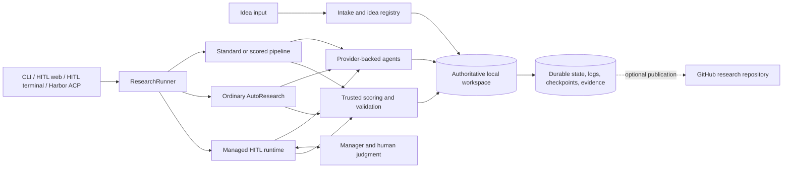

# NeuriCo System Architecture and Direction

> **Developer and agent reference.** This document describes NeuriCo source
> architecture, not the shortest path for running a research task. Users should
> start with the [README](../README.md) or [Workflow Guide](WORKFLOW.md).

## Baseline and evidence policy

This overview is reconciled against the canonical GitHub repository,
[`ChicagoHAI/NeuriCo`](https://github.com/ChicagoHAI/NeuriCo), at `main` commit
[`8d27446cc0da93fda0ebdd26975451a48572d4f5`](https://github.com/ChicagoHAI/NeuriCo/commit/8d27446cc0da93fda0ebdd26975451a48572d4f5)
on 2026-11-06. That commit includes merged PR
[#190](https://github.com/ChicagoHAI/NeuriCo/pull/190), the Harbor ACP adapter.

The architecture is reconstructed from the implementation and tests at that
commit, the merged PRs that introduced the behavior, their review records, and
the supported docs on the same revision. Evidence has this precedence:

1. current code and tests on GitHub `main`;
2. merged PR descriptions and resolved review discussions;
3. current supported documentation;
4. open PRs as proposed behavior, never current behavior;
5. issues as needs, risks, and direction signals;
6. local branches and historical notes as non-authoritative context.

The [refresh procedure](#keeping-this-overview-current) must be run before the
baseline SHA is advanced. A local checkout by itself is not an architecture
source.

### Foundational merged records

This ledger identifies the merged records most useful for reconstructing why
the current architecture exists. It is a navigation aid, not a substitute for
the implementation or the full review timeline.

| Area | Merged records | Architectural result on this baseline |
| --- | --- | --- |
| Interactive manager foundation | [#86](https://github.com/ChicagoHAI/NeuriCo/pull/86), [#113](https://github.com/ChicagoHAI/NeuriCo/pull/113) | Manager tool-use loop, durable interactive state, and world-model/whiteboard foundations |
| Scoring and ordinary AutoResearch | [#117](https://github.com/ChicagoHAI/NeuriCo/pull/117), [#119](https://github.com/ChicagoHAI/NeuriCo/pull/119) | Rule-maker/scorer separation, sealed evaluation, Git-backed propose-score-accept/restore loop |
| Compute portability | [#124](https://github.com/ChicagoHAI/NeuriCo/pull/124), [#132](https://github.com/ChicagoHAI/NeuriCo/pull/132) | Modal skills and runtime-selectable local/DSI Slurm/Modal backends |
| Durable phase boundaries | [#144](https://github.com/ChicagoHAI/NeuriCo/pull/144) | Living `STATE.md` handoffs, workspace identity, artifact and output validation |
| Managed HITL authority model | [#146](https://github.com/ChicagoHAI/NeuriCo/pull/146) | Manager-mediated plans, worker commands, human requests, isolated scoring, runtime-owned transitions and frontier |
| Managed Auto and managed ordinary | [#167](https://github.com/ChicagoHAI/NeuriCo/pull/167), [#181](https://github.com/ChicagoHAI/NeuriCo/pull/181) | Unattended manager-resolved mode and ordinary research through the managed lifecycle |
| Evaluation and recovery hardening | [#172](https://github.com/ChicagoHAI/NeuriCo/pull/172), [#173](https://github.com/ChicagoHAI/NeuriCo/pull/173), [#179](https://github.com/ChicagoHAI/NeuriCo/pull/179), [#183](https://github.com/ChicagoHAI/NeuriCo/pull/183), [#202](https://github.com/ChicagoHAI/NeuriCo/pull/202) | Scoring-contract conformance, repair boundaries, initial resume, timeout recovery, persisted evaluator artifacts |
| Time budgets and extra agents | [#188](https://github.com/ChicagoHAI/NeuriCo/pull/188), [#195](https://github.com/ChicagoHAI/NeuriCo/pull/195) | Selected-frontier budget finalization and attempt-scoped manager-inserted resource finding |
| Workspace and publication hardening | [#199](https://github.com/ChicagoHAI/NeuriCo/pull/199), [#200](https://github.com/ChicagoHAI/NeuriCo/pull/200), [#201](https://github.com/ChicagoHAI/NeuriCo/pull/201), [#203](https://github.com/ChicagoHAI/NeuriCo/pull/203) | Embedded environments, fingerprint-safe handoff, scorer schema validation, baselines/batch/publication hardening |
| Proposal search policy | [#207](https://github.com/ChicagoHAI/NeuriCo/pull/207), [#209](https://github.com/ChicagoHAI/NeuriCo/pull/209) | Independent-ranked/collaborative proposal generation and optional focused research |
| External benchmark adapter | [#190](https://github.com/ChicagoHAI/NeuriCo/pull/190) | Harbor ACP boundary using normal headless managed AutoResearch rather than a forked research engine |

## Executive model

NeuriCo turns a structured research idea into a durable research workspace and
coordinates CLI-based AI agents to discover resources, define an evaluation
contract, implement and run experiments, score results, retain evidence, and
optionally write and publish a paper.

It is best understood as five cooperating systems:

1. **Intake and workspace construction** convert YAML, text/Markdown, or
   IdeaHub input into a normalized idea and an authoritative local workspace.
2. **Research orchestration** routes one of the supported research modes and
   launches role-specific agents through provider CLIs.
3. **Trusted control and evaluation** validate artifacts, isolate evaluator
   authority, checkpoint exact workspace states, and apply transitions.
4. **Durable evidence and recovery** preserve plans, logs, scores, Git
   checkpoints, manager context, attempts, and replayable state.
5. **Interfaces and integrations** expose Docker/local execution, HITL web and
   terminal surfaces, optional GitHub publication, compute backends, and Harbor
   ACP.

The central design idea is not “one autonomous scientist.” It is a separation
of research judgment from trusted mechanism, with increasingly strong control
and recovery boundaries as the user moves from Standard to AutoResearch to
managed HITL AutoResearch.



## Product modes and control models

NeuriCo presents three user-facing research modes. The code also contains
managed ordinary-research and baseline-construction entry paths that support
the HITL journey. These paths share agents and workspace conventions, but their
control and state models are deliberately not interchangeable.

| Mode | Pipeline | Decision owner | Iteration state | Primary modules |
| --- | --- | --- | --- | --- |
| Standard | Resource finder -> experiment runner -> optional paper; scoring can insert rule maker and scorer | Agents complete ordinary stages; orchestrator validates outputs | No research frontier | `runner.py`, `pipeline_orchestrator.py` |
| Ordinary AutoResearch | Scored baseline -> propose -> edit/run -> score -> compare -> accept or restore | Mechanical score comparison using the declared target and tolerance | One accepted current-best Git lineage | `autoresearch.py` |
| Managed HITL AutoResearch | Managed initial pipeline -> root -> proposal -> admission -> experiment -> isolated score -> manager decision -> frontier | Human owns intent; manager owns scientific judgment; runtime applies legal transitions | Multi-node active frontier plus private matching control-state snapshots | `hitl*.py`, `hitl_autoresearch.py`, `hitl_frontier.py` |

Two HITL policies sit on the same managed runtime:

- **Full mode** asks the human at required decision boundaries.
- **Auto mode** keeps manager review at every boundary but resolves decisions
  without waiting for a human. It is used by unattended managed runs and the
  Harbor adapter.

Proposal generation is a configurable sub-policy of managed AutoResearch, not
a new execution engine:

- **Single** proposes one candidate and remains the default.
- **Independent ranked** runs isolated proposers, a verifier per proposal, and
  independent complete rankings, then aggregates rankings for manager
  selection.
- **Collaborative** adds bounded proposer discussion before selection while
  preserving the same admission, execution, scoring, and frontier path.

Optional **focused AutoResearch** narrows a fresh managed run to one active
direction at a time. It changes what the research agents are asked to develop;
it does not replace runtime scoring or frontier authority. These proposal and
focus policies were introduced through merged PRs
[#207](https://github.com/ChicagoHAI/NeuriCo/pull/207) and
[#209](https://github.com/ChicagoHAI/NeuriCo/pull/209).

## End-to-end lifecycle

### 1. Intake and workspace selection

`src/core/idea_manager.py` validates and stores normalized ideas. Submission
entrypoints accept structured YAML, local text/Markdown, or IdeaHub content.
An idea can use a fully local workspace or optional GitHub-backed publication.

The local workspace remains authoritative during execution. A managed HITL
launcher chooses the workspace before the run; connecting GitHub may create or
recover a publication repository but cannot replace the selected local state.
New workspaces record a dependency layout:

- `native`: the workspace root is also the Python project;
- `embedded`: NeuriCo-owned metadata and `.venv` live under
  `neurico-research-env/`, leaving an externally owned root environment alone.

The embedded mode, formalized in merged PR
[#199](https://github.com/ChicagoHAI/NeuriCo/pull/199), is essential for Harbor
and other externally supplied repositories.

### 2. Routing and compatibility validation

`src/core/runner.py` is the shared routing boundary. It validates incompatible
flags, selects provider, compute backend, workspace layout, publication policy,
and research control mode, then dispatches to the appropriate engine.

These are separate dimensions:

| Dimension | Current choices |
| --- | --- |
| Provider CLI | Claude, Codex, Gemini; managed HITL currently requires Claude or Codex |
| Compute backend | local, DSI Slurm, Modal |
| Workspace layout | native, embedded |
| Control mode | Standard, ordinary AutoResearch, managed HITL Full or Auto |
| Interface | command line, HITL browser, HITL terminal, Harbor ACP |
| Publication | local only or optional GitHub research repository |

Provider model override is run-wide. Compute selection is attached to the idea
and controls which backend skill is installed; it must not silently alter the
research control policy.

### 3. Standard and scored pipeline

`src/core/pipeline_orchestrator.py` runs the ordinary stage graph and records it
in `.neurico/pipeline_state.json`. `src/core/phase_state.py` regenerates the
human-readable `STATE.md` projection. The orchestrator validates completion,
required artifacts, workspace health, fingerprints, and workflow identity.

The ordinary graph is:

```text
resource finder -> experiment runner -> optional paper writer
```

With scoring enabled, it becomes:

```text
resource finder -> rule maker -> seal evaluator -> experiment runner
                -> unseal evaluator -> scorer -> optional paper writer
```

Bootstrap paths convert an existing Standard workspace into a scored baseline.
They build a mechanical workspace manifest, ask a trimmer agent to curate it,
construct the scoring contract without exposing target outputs, run the scorer,
and optionally publish continuation state. Ordinary and managed HITL baseline
construction write different continuation models.

### 4. Ordinary AutoResearch

Ordinary AutoResearch was established by merged PRs
[#117](https://github.com/ChicagoHAI/NeuriCo/pull/117) and
[#119](https://github.com/ChicagoHAI/NeuriCo/pull/119). It is a mechanical
single-lineage optimizer:

```text
accepted best checkpoint
  -> propose one change
  -> apply and run candidate
  -> score candidate with sealed evaluator
  -> compare target metric with tolerance
  -> accept candidate as new best or restore parent
  -> repeat
```

`src/core/autoresearch.py` owns the controller and `CheckpointManager`.
`.neurico/autoresearch_state.json` records the history root, lineage source,
current best SHA, and last iteration. Attempt evidence lives under
`logs/experiment-autoresearch/` and remains inspectable even when a candidate
is rejected.

Workspace Git `HEAD` represents the accepted best public result. Checkpointing
excludes private evaluator material, runtime-only state, transient remote
compute files, paper output, and other non-frontier artifacts. Recovery restores
the current best before new work; it does not treat a dirty interrupted attempt
as a valid candidate.

### 5. Managed HITL lifecycle

The managed path, consolidated by merged PR
[#146](https://github.com/ChicagoHAI/NeuriCo/pull/146), replaces ordinary stage
completion with runtime-held commands and manager review.

Each stage has a living public plan and an execution phase. A worker calls a
runtime finalizer and waits. The runtime checks mechanical conditions, then the
manager reviews semantic adequacy and either approves, requests revision, or
asks the human when Full mode requires intent. A worker cannot advance its own
phase, and manager prose cannot replace a required finalizer.

A fresh managed AutoResearch run creates its root through:

```text
resource finder
  -> rule maker and scoring-contract review
  -> experiment runner
  -> exact reviewed checkpoint
  -> isolated scoring
  -> manager validity review or repair
  -> automatic root-frontier publication
```

Each later iteration follows:

```text
selected frontier node
  -> optional attempt-scoped additional resource finder
  -> proposal generation policy
  -> manager legality review and human admission when required
  -> living experiment plan and execution
  -> exact reviewed checkpoint and isolated scoring
  -> manager accept / reject / repair
  -> frontier pruning and next-node selection
```

Merged PR [#195](https://github.com/ChicagoHAI/NeuriCo/pull/195) added the
attempt-scoped additional-agent boundary. Its runs use the normal managed
plan/execution/review lifecycle but do not change frontier identity.

Accepted exploitation replaces the parent in that active direction. Accepted
exploration can retain both parent and child. Rejections stay in audit history
but not in the active frontier. The active frontier is capped at ten nodes;
manager-only pruning and selection are separate boundaries.

### 6. Finalization and publication

At run end, NeuriCo selects or restores the retained result, produces user
artifacts, optionally writes a paper, updates idea status, and optionally
publishes to GitHub. Managed time budgets stop active work and finalize the
selected accepted frontier rather than treating a partially executed candidate
as complete, following merged PR
[#188](https://github.com/ChicagoHAI/NeuriCo/pull/188).

Publication is a security boundary. Staged content is scanned and sanitized;
large files, binary artifacts, core dumps, logs, credentials, and runtime-only
state require explicit handling. Merged PR
[#203](https://github.com/ChicagoHAI/NeuriCo/pull/203) strengthened publication
and batch/baseline behavior, while open issue
[#153](https://github.com/ChicagoHAI/NeuriCo/issues/153) records the broader
requirement that failure paths receive the same secret-safety guarantees.

## Authority and trust boundaries

Managed HITL depends on a strict responsibility split.

| Actor | Owns | Must not own |
| --- | --- | --- |
| Human | Intent, preferences, scope, access, risk tolerance, required approvals | Runtime state or evaluator transport |
| Manager | Semantic review, scientific interpretation, worker feedback, proposal/frontier decisions | Direct workspace mutation or unchecked transitions |
| Worker | Research, implementation, experiments, public evidence, living plans, proposals | Official HITL state, phase approval, evaluator authority |
| Trusted runtime | Command validation, allowed tools, fingerprints, locks, checkpoints, scoring isolation, transitions, recovery | Scientific merit or research strategy |
| Provider/model API | Bounded inference for agents or verifier | Local state authority |
| GitHub | Optional remote record and publication target | Live workspace authority |

The runtime may reject an illegal command, protected-path change, missing
artifact, stale fingerprint, invalid schema, or broken checkpoint. It must not
turn a low score into a scientific rejection. That distinction is the core
managed-runtime invariant.

Application-level guards are not an operating-system sandbox. Full-permission
workers can still access capabilities allowed by the host/container. Treat
agent output, fetched web content, idea text, workspace files, and remote PR or
issue text as untrusted input.

## Scoring and evaluator isolation

The rule maker defines:

- `scoring/interface.md`: public artifact contract for the experiment worker;
- `scoring/eval.py`: evaluator implementation;
- `scoring/targets.json`: target metric and comparison direction;
- `scoring/rule_maker_log.md`: optional evaluator-construction record;
- private evaluator inputs, commonly under `data/.test/`.

`src/core/scoring_seal.py` creates and fsyncs a hash manifest, moves private
payload out of the public worker surface, and applies immutable protections
where available. Unsealing validates the manifest before scoring.

Managed scoring adds stronger isolation:

1. verify the reviewed public-workspace fingerprint;
2. checkpoint the exact reviewed state;
3. create a private detached Git worktree;
4. restore the sealed evaluator and permitted data there;
5. run the scorer using the candidate workspace's task dependencies;
6. commit the private result and publish an integrity-checked review copy;
7. hand complete score evidence and provenance to the manager.

The public `scoring/results.json` is review evidence, not scoring authority.

When the idea declares an evaluation contract, a bounded, tool-less verifier
checks allowlisted scorer/function source through OpenRouter or OpenAI. The
runtime reduces the remote response to fixed statuses and does not persist raw
model output in HITL state. HITL treats provider unavailability as advisory and
visible; non-HITL scoring treats conformance as a gate. The external disclosure
of allowlisted source is a data-governance decision, not a local sandbox.

## Durable state and evidence

NeuriCo deliberately stores different kinds of truth separately.

| Location | Authority and lifetime |
| --- | --- |
| Idea YAML/registry | Normalized input, metadata, status, workspace/publication link |
| Workspace public files | Research implementation and evidence visible to workers and users |
| `STATE.md` | Human-readable projection; runtime-owned in managed workflows |
| `.neurico/pipeline_state.json` | Ordinary or managed initial-stage progress and workflow identity |
| `.neurico/autoresearch_state.json` | Ordinary AutoResearch single-best continuation state |
| `.neurico/hitl/runtime.json` | Active managed request, boundary, continuation, and replayable transition state |
| `.neurico/hitl/autoresearch_state.json` | Managed selected node, active frontier, and continuation metadata |
| `.neurico/hitl/nodes/` | Accepted nodes, saved plans, attempts, and frontier evidence |
| `.neurico/hitl/idea/idea.jsonl` | Append-only finalized managed idea/decision audit log |
| `.neurico/hitl/manager/` | Active manager context, full SQLite archive, and durable human inbox |
| `.neurico/hitl/whiteboard/` | Cross-attempt managed research lessons |
| `.neurico/research_state.json` | Rebuildable interface projection and synthesis |
| `logs/` and `artifacts/` | Execution/transcript evidence, not transition authority |
| Workspace Git refs | Public checkpoints and private matching HITL control snapshots |
| GitHub research repository | Optional sanitized publication, not the running state machine |

State files use atomic replacement and the relevant workspace/run locks. Public
checkpoints intentionally exclude hidden control state, so managed workflows
store matching private snapshots in local Git refs. Recovery restores both the
public workspace and compatible private state before resuming a held request,
scoring handoff, root publication, or failed attempt.

Private refs are durability machinery. They are not research branches and are
not pushed during ordinary publication.

## Implementation map

### Entry and interface layer

| Concern | Modules |
| --- | --- |
| Submit/fetch ideas | `src/cli/submit.py`, `src/cli/submit_local.py`, `src/cli/fetch_from_ideahub.py` |
| Shared research routing | `src/core/runner.py` |
| HITL launch and fresh/continue detection | `src/cli/hitl_launcher.py`, `src/cli/hitl_web.py`, `src/cli/hitl_cli.py` |
| HITL interfaces | `src/interactive/hitl_web_server.py`, `src/interactive/hitl_terminal_ui.py` |
| GitHub publication | `src/core/github_manager.py`, `src/core/security.py` |
| Harbor ACP | `integrations/harbor/` |

### Research and agent layer

| Concern | Modules |
| --- | --- |
| Ordinary stage orchestration | `src/core/pipeline_orchestrator.py`, `src/core/phase_state.py` |
| Provider processes, transcripts, cancellation | `src/core/agent_runner.py`, `src/core/agent_cli.py` |
| Resource/rule/proposal/paper roles | `src/agents/` |
| Prompts, domain overlays, skills | `templates/`, `src/templates/prompt_generator.py` |
| Compute and dependency environment | `src/core/compute_backend.py`, `src/core/research_environment.py` |

### Trusted state and evaluation layer

| Concern | Modules |
| --- | --- |
| Ordinary AutoResearch/checkpoints | `src/core/autoresearch.py`, `src/core/autoresearch_common.py` |
| Scorer/sealing/conformance | `src/core/scorer.py`, `src/core/scoring_seal.py`, `src/agents/eval_verifier.py` |
| Managed worker protocol | `src/core/hitl.py`, `src/core/hitl_stage_runtime.py`, `src/core/hitl_runtime_state.py` |
| Managed initial/iterative engine | `src/core/hitl_autoresearch.py` |
| Frontier and private snapshots | `src/core/hitl_frontier.py`, `src/core/hitl_git.py`, `src/core/hitl_git_state.py` |
| Scoring worktrees | `src/core/hitl_scoring_workspace.py` |
| Guard/fingerprint/artifact snapshots | `src/core/hitl_workspace_guard.py`, `src/core/hitl_workspace_inspection.py`, `src/core/hitl_artifact_snapshots.py` |
| Manager context/history/inbox | `src/core/hitl_manager_context.py`, `src/core/hitl_manager_history.py`, `src/core/hitl_manager_inbox.py` |
| Manager reasoning and tool policy | `src/core/hitl_manager_react.py`, `src/core/hitl_manager_mcp.py`, `src/core/hitl_manager_host.py` |
| Proposal panels and extra agents | `src/core/hitl_proposal_round.py`, `src/core/hitl_proposal_discussion.py`, `src/core/manager_additional_agents.py` |

Some files are large because they encode state machines with many recovery
boundaries: `hitl.py`, `hitl_autoresearch.py`, `pipeline_orchestrator.py`,
`hitl_runtime_state.py`, and `hitl_manager_react.py` deserve targeted reading
before modification. A function-local patch can still change a cross-file
durability contract.

## Major implementation decisions

### Workspace first, publication second

Research must survive without GitHub. The local workspace owns live execution;
GitHub is optional storage/publication. This enables local-only use, managed
restart, and Harbor's externally supplied repository contract.

### Judgment is separate from mechanism

The manager and human decide meaning; trusted Python applies legal transitions.
This avoids embedding research policy into score thresholds or file checks and
makes reviews auditable.

### Evaluation is designed before candidate optimization

The rule maker defines the artifact interface and hidden evaluator before the
experiment worker sees the task. Sealing, fingerprints, and detached worktrees
reduce evaluator leakage and candidate-authored score manipulation.

### Git checkpoints identify exact research states

Ordinary AutoResearch uses one best lineage. Managed HITL uses public
checkpoints plus private control snapshots and a frontier. Both designs prefer
content-addressed recovery over reconstructing state from prose logs.

### Completion is a protocol, not a message

Required runtime commands, artifact schemas, path guards, fingerprints, and
checkpoints define completion. This is why a worker's “done” or a manager's
prose approval cannot advance the workflow on its own.

### Recovery is part of every transition

Held commands, finalized feedback, scoring handoffs, frontier publication,
time-budget finalization, provider failure, and worker replacement are durable
cases, not exceptional afterthoughts. Recovery should continue a prepared
request, not normalize and execute it a second time.

### Public and private state are intentionally different

Users and workers need transparent plans, artifacts, and reviewable scores.
They do not need evaluator secrets or mutable official control state. Separate
storage and refs let NeuriCo expose evidence without surrendering authority.

### Prompt contracts and Python runtime evolve together

Templates tell agents which commands, artifacts, and boundaries exist; Python
validates them. Because checkout templates can be mounted into Docker images,
template-only changes can still break older runtime code. Merged PR
[#209](https://github.com/ChicagoHAI/NeuriCo/pull/209) is a recent example: its
review required compatibility with older prompt-generator call signatures.

### External integrations translate boundaries, not research logic

The Harbor adapter preserves the original task instruction and invokes normal
headless managed AutoResearch. It owns ACP model/auth/cancellation/deadline
translation and process cleanup, but not a second optimizer, manager, or
recovery implementation. On successful handoff it preserves detached task
services needed by Harbor's verifier; on failure, cancellation, or forced stop
it cleans owned descendants.

## Known limitations and architectural pressure

These observations combine code structure with merged review findings. They
are not promises of scheduled work.

- **Large control modules.** Core state machines span thousands of lines and
  repeated boundary logic. Extracting typed transition services could reduce
  coupling, but must preserve atomicity and replay semantics.
- **Parallel control models.** Ordinary and managed AutoResearch intentionally
  differ, yet share scoring, checkpoint, and agent concepts. Changes must be
  applied selectively or factored below the authority boundary.
- **Ignored environment state.** Git/public artifact checkpoints do not fully
  represent mutations inside a persistent ignored `.venv`; review of PR #195
  identified this as a broader rollback limitation.
- **Application guards are not a sandbox.** Full-permission agents and hostile
  colocated processes remain outside what path checks alone can contain. Open
  issue [#155](https://github.com/ChicagoHAI/NeuriCo/issues/155) tracks a related
  input trust-boundary concern.
- **Prompt compliance is partly behavioral.** Search breadth, resource
  retention, and some background-process rules rely on agent adherence even
  when runtime guards the consequential transition.
- **Compatibility surface is broad.** Provider, model, Docker image, checkout
  template, domain overlay, compute backend, workspace layout, mode, and
  continuation version interact. Matrix testing is more valuable than a
  single happy-path invocation.
- **Test concentration.** The current suite is strongest around HITL recovery,
  scoring, workspace protection, security, state, baselines, and templates;
  the overall control surface is larger than the 25 top-level test modules
  present at this baseline.
- **Roadmap records can lag implementation.** Some open issues describe work
  partly addressed by merged PRs. Status must be reconciled against code and
  PR history rather than copied from issue state.

## Direction from GitHub records

This section distinguishes shipped architecture from active proposals and
longer-term needs. The ordering below is an evidence-based recommendation, not
an approved project schedule.

### Active implementation signals at the baseline

The following open PR groups were inspected during this refresh. Their status
is **proposed/in review** until GitHub records a merge into `main`.

| Direction | Open PR evidence |
| --- | --- |
| Restart and failure correctness | [#211 raised-request recovery](https://github.com/ChicagoHAI/NeuriCo/pull/211), [#208 managed-agent failure propagation](https://github.com/ChicagoHAI/NeuriCo/pull/208), [#193 terminated-agent output](https://github.com/ChicagoHAI/NeuriCo/pull/193), [#184 submission/workspace collision](https://github.com/ChicagoHAI/NeuriCo/pull/184) |
| Resource discovery | [#210 query rewriting and citation tracing](https://github.com/ChicagoHAI/NeuriCo/pull/210), [#101 dynamic resource finding](https://github.com/ChicagoHAI/NeuriCo/pull/101) |
| Safety and publication | [#204 continuous safety engine](https://github.com/ChicagoHAI/NeuriCo/pull/204), [#170 staged secret sanitization](https://github.com/ChicagoHAI/NeuriCo/pull/170) |
| Human interaction and observability | [#198 status thinking](https://github.com/ChicagoHAI/NeuriCo/pull/198), [#194 structured feedback](https://github.com/ChicagoHAI/NeuriCo/pull/194), [#161 submission/lobby](https://github.com/ChicagoHAI/NeuriCo/pull/161), [#123 trajectory evidence](https://github.com/ChicagoHAI/NeuriCo/pull/123), [#74 HTML reports](https://github.com/ChicagoHAI/NeuriCo/pull/74) |
| Cost, providers, and resource control | [#191 budget management](https://github.com/ChicagoHAI/NeuriCo/pull/191), [#125 Requesty backend](https://github.com/ChicagoHAI/NeuriCo/pull/125), [#103 budget tracking](https://github.com/ChicagoHAI/NeuriCo/pull/103), [#78 token/cost summary](https://github.com/ChicagoHAI/NeuriCo/pull/78) |
| Reliability and test coverage | [#98 persistent attempts](https://github.com/ChicagoHAI/NeuriCo/pull/98), [#84 retry mechanism](https://github.com/ChicagoHAI/NeuriCo/pull/84), [#82 test expansion](https://github.com/ChicagoHAI/NeuriCo/pull/82) |

### 1. Make restart semantics complete and uniform

Durability is the highest-leverage near-term direction because every new
managed feature creates more boundaries to replay. Open PR
[#211](https://github.com/ChicagoHAI/NeuriCo/pull/211) proposes preserving
raised requests and provenance across restart; open PR
[#208](https://github.com/ChicagoHAI/NeuriCo/pull/208) addresses ordinary
managed-agent failure propagation; issue
[#18](https://github.com/ChicagoHAI/NeuriCo/issues/18) captures the older retry
and recovery need.

Preferred architectural direction: one explicit transition journal or typed
transition API with idempotency keys, request provenance, pre/post
fingerprints, and recovery tests for every durable boundary.

### 2. Improve resource intelligence without weakening evidence quality

Resource quality remains a core research bottleneck. Open PR
[#210](https://github.com/ChicagoHAI/NeuriCo/pull/210) proposes bounded query
rewriting and citation tracing at the prompt layer. Issues
[#50](https://github.com/ChicagoHAI/NeuriCo/issues/50),
[#89](https://github.com/ChicagoHAI/NeuriCo/issues/89), and
[#121](https://github.com/ChicagoHAI/NeuriCo/issues/121) call for reliable
source discovery, a standalone literature-review surface, and current-method
critique.

Preferred direction: make evidence provenance and retrieval evaluation
first-class before adding unrestricted search breadth. Measure source
retention, supported cross-domain additions, unsupported claims, and cost.

### 3. Strengthen security and evaluation trust

Open PR [#204](https://github.com/ChicagoHAI/NeuriCo/pull/204) proposes a large
continuous AI-safety evaluation subsystem. Issues
[#153](https://github.com/ChicagoHAI/NeuriCo/issues/153) and
[#155](https://github.com/ChicagoHAI/NeuriCo/issues/155), plus merged OAuth-log
redaction PR [#169](https://github.com/ChicagoHAI/NeuriCo/pull/169), show the
cross-cutting need for secret handling and explicit trust models.

Preferred direction: define one repository-wide threat model and data-flow
inventory covering idea input, fetched content, provider prompts, evaluator
source disclosure, logs, local credentials, task services, and every GitHub
publication path. Large subsystems should integrate only after their daemon,
queue, knowledge-base, and evaluator authorities are reconciled with existing
HITL state ownership.

### 4. Add observability from durable events

Issue [#49](https://github.com/ChicagoHAI/NeuriCo/issues/49) asks for rich
reports, comparisons, and progress views. Open PR
[#198](https://github.com/ChicagoHAI/NeuriCo/pull/198) proposes exposing current
manager thinking in `/status`; open PR
[#123](https://github.com/ChicagoHAI/NeuriCo/pull/123) proposes trajectory
visualization from raw evidence.

Preferred direction: expose a versioned, read-only event/projection interface
derived from authoritative state. UIs and reports should not scrape logs or
become a second workflow authority.

### 5. Consolidate operator surfaces

Issue [#52](https://github.com/ChicagoHAI/NeuriCo/issues/52) and open PR
[#161](https://github.com/ChicagoHAI/NeuriCo/pull/161) point toward easier web
submission and run management. The current dedicated HITL interfaces already
project durable state and should remain the base.

Preferred direction: one task/run model across submission, launch, monitoring,
human requests, continuation, and final artifacts, with web/terminal as clients
of the same runtime API.

### 6. Make cost, model, and capacity policy explicit

Open PRs [#191](https://github.com/ChicagoHAI/NeuriCo/pull/191) and
[#125](https://github.com/ChicagoHAI/NeuriCo/pull/125), plus issues
[#47](https://github.com/ChicagoHAI/NeuriCo/issues/47),
[#91](https://github.com/ChicagoHAI/NeuriCo/issues/91), and
[#14](https://github.com/ChicagoHAI/NeuriCo/issues/14), cover budget control,
alternative routing, local models, and resource capacity.

Preferred direction: a provider-agnostic policy layer for model capabilities,
token/currency budgets, compute capacity, deadlines, and fallback. It should
emit durable accounting events and remain separate from scientific acceptance.

### 7. Treat memory as governed research state

Historical or unmerged work explored context/working memory, experience
memory, and decision logs, including PRs
[#154](https://github.com/ChicagoHAI/NeuriCo/pull/154),
[#126](https://github.com/ChicagoHAI/NeuriCo/pull/126), and
[#134](https://github.com/ChicagoHAI/NeuriCo/pull/134). Current main already has
attempt history, manager context/history, a whiteboard, and durable idea logs.

Preferred direction: define what is evidence, what is a lossy projection, what
can influence future agents, and how stale or rejected lessons are corrected.
Do not add another memory store without lifecycle, provenance, retrieval, and
deletion rules.

## Open research questions

The long-term questions recorded in roadmap issue
[#53](https://github.com/ChicagoHAI/NeuriCo/issues/53) remain useful even as
implementation has advanced:

1. How should NeuriCo measure research behavior rather than only final task
   score?
2. Which reflections or critiques generalize across attempts without importing
   stale assumptions?
3. How much domain specificity should live in templates, tools, evaluators, or
   runtime policy?
4. Which artifacts best support a human selector or evaluator making a real
   research decision?
5. How should exploration diversity be balanced against cost, reproducibility,
   and reliable recovery?

These are product and research questions. They should not be resolved by
silently adding policy to trusted runtime code.

## Change-impact guide for agents

| If you change... | Also inspect and test... |
| --- | --- |
| A CLI flag or launch field | Docker launcher, HITL detached launcher, continuation persistence, Harbor allowlist, docs |
| A stage or required artifact | Prompt contract, phase state, output validation, repair/replacement, bootstrap, recovery |
| A managed runtime command | Tool schema, runtime state, manager prompt, worker prompt, idempotency, restart/replay, both UIs |
| Scoring files or transport | Seal manifest, conformance verifier, workspace fingerprint, detached worktree, manager handoff, publication |
| Checkpoint contents | Ordinary rollback, HITL private snapshot, ignored/task-owned files, GitHub sanitization |
| Proposal policy | Single/ranked/collaborative normalization, task isolation, recovery, manager selection, UI configuration |
| Templates or skills | Provider/domain/workspace rendering matrix, Docker old-image compatibility, selected compute skill |
| Provider process lifecycle | process groups, transcript closure, timeout, cancellation, replacement, Harbor supervisor cleanup |
| GitHub publication | local-only behavior, failed-run cleanup, secret redaction, large/binary files, repo identity |
| Durable state schema | atomic write, lock scope, migration/backward compatibility, stale and duplicate events |

## Keeping this overview current

For every architecture refresh:

1. Resolve the canonical repository through GitHub and record the full current
   `main` SHA and date.
2. Compare that SHA with this document's baseline.
3. Read every merged PR in the range, including material review threads and the
   final implementation—not only the PR title.
4. Inspect current code, tests, and supported docs for each changed subsystem.
5. Search open PRs for overlapping work. Keep them in “active proposal” status
   until merged.
6. Search open and recently closed issues for risks, superseded plans, and
   unresolved acceptance criteria.
7. Update the mode map, authority boundaries, state paths, implementation map,
   decisions, limitations, and direction separately.
8. Check every linked module/path and run `git diff --check`.
9. Advance the baseline SHA only after the reconciliation is complete.

When sources disagree, document the discrepancy and prefer current merged code
plus its tests. A PR body explains intent; the merged diff and resolved review
record show what survived implementation.
