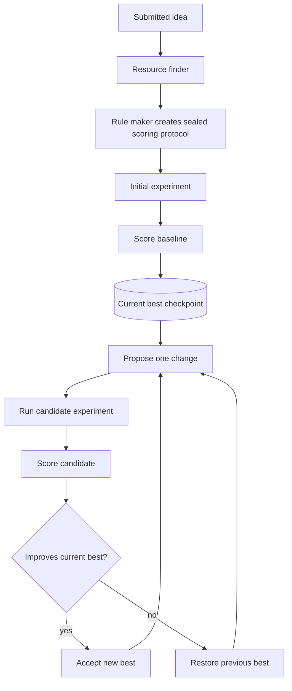

# AutoResearch

AutoResearch is one of NeuriCo's three research modes. It turns an initial
scored experiment into an iterative improvement loop. Each iteration proposes
one change, runs it, scores it against a sealed evaluation protocol, and keeps
the change only when it improves the current best result.

Fresh, continue, and bootstrap are entry paths within AutoResearch, not separate
user-facing research modes.

## Start AutoResearch

The following example creates a scored baseline and runs three improvement
iterations:

| Docker | Local `uv` |
| --- | --- |
| `./neurico run <idea_id> --provider claude --no-github --full-permissions --autoresearch --autoresearch-iterations 3` | `uv run python src/core/runner.py <idea_id> --provider claude --no-github --full-permissions --autoresearch --autoresearch-iterations 3` |

Omit `--no-github` when the idea has a configured GitHub repository. Replace
`claude` with `codex` or `gemini` after authenticating that provider.

## Continue AutoResearch

Continue from a workspace that already contains a scored best result:

| Docker | Local `uv` |
| --- | --- |
| `./neurico run <idea_id> --provider claude --no-github --full-permissions --continue-autoresearch --autoresearch-iterations 3` | `uv run python src/core/runner.py <idea_id> --provider claude --no-github --full-permissions --continue-autoresearch --autoresearch-iterations 3` |

The existing workspace must have complete scoring files, a valid Git `HEAD`,
and no uncommitted changes. If an interrupted AutoResearch attempt left the
workspace dirty, add `--continue-recover`. This restores the current best
checkpoint, discards the incomplete attempt, and continues:

| Docker | Local `uv` |
| --- | --- |
| `./neurico run <idea_id> --provider claude --no-github --full-permissions --continue-autoresearch --continue-recover --autoresearch-iterations 3` | `uv run python src/core/runner.py <idea_id> --provider claude --no-github --full-permissions --continue-autoresearch --continue-recover --autoresearch-iterations 3` |

## Bootstrap an existing workspace

Bootstrap is for a workspace where Standard research already produced useful
outputs but no scored AutoResearch baseline exists. The baseline command curates
the existing workspace manifest, constructs the scoring contract, scores the
current implementation, creates the best checkpoint, and writes AutoResearch
continuation state. It does not run improvement iterations.

```bash
# Docker: create the continuation-ready baseline
./neurico run <idea_id> --provider claude --no-github \
  --bootstrap-autoresearch-baseline

# Docker: then run improvements
./neurico run <idea_id> --provider claude --no-github \
  --continue-autoresearch --autoresearch-iterations 3
```

```bash
# Local uv: create the continuation-ready baseline
uv run python src/core/runner.py <idea_id> --provider claude --no-github \
  --bootstrap-autoresearch-baseline

# Local uv: then run improvements
uv run python src/core/runner.py <idea_id> --provider claude --no-github \
  --continue-autoresearch --autoresearch-iterations 3
```

The lower-level `--bootstrap-rule-maker` flag retrofits a scoring protocol and
runs the scorer, but it is not the preferred entrypoint when the goal is a
continuation-ready AutoResearch baseline.

## Integrating an external evaluator

To connect an existing benchmark or evaluator, use `scoring/eval.py` as an
adapter. When invoked as `python scoring/eval.py` from the workspace root, it
must read the candidate artifacts, run the evaluator, and write
`scoring/results.json` before exiting with code `0`. A successful scorer process
and a JSON object are not sufficient for AutoResearch: the result must contain
comparable metrics in a non-empty `properties` object.

For a benchmark where higher scores are better and the target is `0.8`, a
complete single-score result is:

```json
{
  "properties": {
    "benchmark_score": {
      "value": 0.72,
      "target": 0.8,
      "direction": "max",
      "satisfied": false
    }
  },
  "overall_satisfied": false
}
```

Each property has these fields:

| Field | Meaning |
| --- | --- |
| `value` | The measured score, as a finite number |
| `target` | The benchmark's success threshold, as a finite number |
| `direction` | `"max"` for higher-is-better metrics, `"min"` for lower-is-better metrics |
| `satisfied` | JSON boolean: `value >= target` for `"max"`, or `value <= target` for `"min"` |

The benchmark defines the target and direction. Read them from
`scoring/targets.json`, as with a rule-maker-generated evaluator. Keep property
names, targets, and directions consistent between the baseline and every
candidate; AutoResearch rejects comparisons when they change. The target is a
success threshold, not the current best score. For a single score,
`overall_satisfied` equals that property's `satisfied` value; for multiple scores,
compute it using the success rule in `scoring/targets.json`.

For example, after obtaining `score` from the external evaluator, the adapter
can write the result using only the Python standard library:

```python
import json
from pathlib import Path

scoring_dir = Path(__file__).resolve().parent
spec = json.loads((scoring_dir / "targets.json").read_text(encoding="utf-8"))
metric = spec["properties"]["benchmark_score"]
target = metric["target"]
direction = metric["direction"]
if direction == "max":
    satisfied = score >= target
elif direction == "min":
    satisfied = score <= target
else:
    raise ValueError("direction must be 'max' or 'min'")

results = {
    "properties": {
        "benchmark_score": {
            "value": score,
            "target": target,
            "direction": direction,
            "satisfied": satisfied,
        }
    },
    "overall_satisfied": satisfied,
}
(scoring_dir / "results.json").write_text(
    json.dumps(results, indent=2, allow_nan=False) + "\n", encoding="utf-8"
)
```

Convert evaluator-specific numeric types to Python numbers before serialization.
Returning only an evaluator's native object, such as `{"score": 0.72}`, leaves
AutoResearch without comparable properties. AutoResearch compares the individual
properties; `overall_satisfied` alone does not determine whether a candidate
improves. With the single-score example above, `0.75` improves on `0.72` even
though neither reaches the target. For a `"min"` metric, a lower value improves
the score instead.

## How the loop works



One iteration performs these steps:

1. Restore the current best checkpoint.
2. Write one proposed change to the attempt's `proposal.md`.
3. Apply the proposal and run the candidate experiment.
4. Execute the sealed evaluator and write candidate results.
5. Compare the candidate against the current best.
6. Accept the candidate as the new best or restore the previous best.

The workspace Git `HEAD` always represents the current best accepted result.
Rejected attempts remain available in the history directory for review.

## Main flags

| Flag | Type / default | Description |
| --- | --- | --- |
| `--autoresearch` | switch | Create the scored baseline, then enter the AutoResearch loop |
| `--continue-autoresearch` | switch | Resume from an existing scored best workspace |
| `--bootstrap-autoresearch-baseline` | switch | Convert an existing unscored workspace into a continuation-ready baseline |
| `--continue-recover` | switch | Restore the best checkpoint before continuing an interrupted run |
| `--autoresearch-iterations N` | integer, default `1` | Number of improvement iterations |
| `--autoresearch-history-dir PATH` | path, default `logs/experiment-autoresearch` | Attempt-history location |
| `--proposer-timeout SECONDS` | integer, default `900` | Timeout for proposal generation |
| `--rule-maker-timeout SECONDS` | integer, default `1800` | Timeout for scoring-contract construction |
| `--scorer-timeout SECONDS` | integer, default `600` | Timeout for scoring |
| `--manifest-trimmer-timeout SECONDS` | integer, default `300` | Timeout per manifest-trimmer call during bootstrap |
| `--bootstrap-rule-maker` | switch | Lower-level scoring-only retrofit for an existing workspace |

`--autoresearch`, `--continue-autoresearch`, and
`--bootstrap-autoresearch-baseline` are mutually exclusive entry paths.

## Outputs

- Current best score: `scoring/results.json`.
- Current best implementation: the workspace Git `HEAD`.
- Attempt history:
  `logs/experiment-autoresearch/<parent_sha>/attempt-<n>/`.
- Per-attempt artifacts: proposal, results, and accept/reject decision.
- Optional paper: `paper_draft/` when `--write-paper` is enabled.

For human-guided iterative research, use HITL AutoResearch instead. See
[`HITL_AUTORESEARCH.md`](HITL_AUTORESEARCH.md).
